# 📘 Documento de Especificación de Requisitos del Software (ERS) — Versión 2.0
## Proyecto: Pastelería Mil Sabores — E-commerce & Sistema Administrativo
**Asignatura:** Desarrollo Fullstack II (DSY1104) — Duoc UC  
**Evaluación:** Evaluación Parcial N° 2 (Ponderación 30%)  
**Fecha:** Octubre 2026  
**Versión:** 2.0 (Propuesta Final Frontend React + Testing Jasmine/Karma)

---

## 1. Introducción y Propósito

### 1.1 Propósito del Documento
El presente documento constituye la **Especificación de Requisitos de Software (ERS) Versión 2.0** para la plataforma web de comercio electrónico y gestión administrativa de **Pastelería Mil Sabores**, con motivo de la celebración de sus 50 años de trayectoria artesanal (1976 - 2026). Define formalmente los requerimientos funcionales, requerimientos no funcionales, arquitectura tecnológica basada en **React 18**, gestión de persistencia mediante base de datos simulada en JavaScript, y el esquema de aseguramiento de calidad con pruebas unitarias en **Jasmine y Karma**.

### 1.2 Alcance del Sistema
La plataforma permite a clientes explorar el catálogo segmentado por categorías, consultar fichas técnicas, aplicar cupones de descuento, gestionar el carrito de compras, completar el proceso de checkout con autofill de datos según sesión iniciada, recibir boleta electrónica imprimible o despachada por correo, y acceder a artículos y recetas en video. Simultáneamente, provee a administradores y vendedores paneles de analítica en tiempo real (Dashboard), gestión de inventario crítico, control de órdenes/boletas, y mantenedores CRUD con persistencia reactiva.

---

## 2. Arquitectura Tecnológica y Estándares

| Componente | Tecnología Seleccionada | Justificación Técnica |
| :--- | :--- | :--- |
| **Framework Frontend** | React 18 (Vite 5) | Componentización bajo principio de *Single Responsibility*, virtual DOM reactivo, HMR instantáneo y empaquetado optimizado. |
| **Enrutamiento** | React Router DOM v6 | Enrutamiento declarativo del lado del cliente (`BrowserRouter`), layout wrappers (`StoreLayout`, `AdminLayout`) y protección de rutas por roles. |
| **Framework de Estilos** | Bootstrap 5.3 + Custom CSS | Diseño 100% responsivo adaptable a dispositivos móviles, tablets y escritorios (`col-*`, flexbox, grid) con tokens visuales pasteles y tipografía *Playfair Display*. |
| **Persistencia de Datos** | Simulación JS + LocalStorage | Módulo `src/services/db.js` con persistencia local en tiempo real, emisión de eventos `storage-updated` y almacenamiento estructurado de entidades. |
| **Motor de Pruebas** | Jasmine 5 + Karma 6 | Entorno de ejecución de pruebas unitarias en navegador headless (*ChromeHeadlessNoSandbox*), assertions expresivas y soporte de mocks/spies. |
| **Transpilador de Pruebas** | Webpack 5 + Babel Loader | Preprocesamiento de JSX, sintaxis moderna ES6+ y soporte de React Testing Library para aislamiento de componentes. |

---

## 3. Requerimientos Funcionales (RF)

### 3.1 Módulo Tienda Online (Público y Clientes)

- **RF01 — Catálogo y Filtrado por Categorías:**
  - El sistema debe listar los productos disponibles con paginación/grilla responsiva.
  - El usuario puede filtrar por 8 categorías oficiales (*Tortas Cuadradas, Tortas Circulares, Postres Individuales, Productos Sin Azúcar, Pastelería Tradicional, Productos Sin Gluten, Productos Veganos, Tortas Especiales*) y por término de búsqueda en tiempo real.
  - Ordenamiento por: destacados, precio ascendente, precio descendente y orden alfabético.

- **RF02 — Ficha Detallada de Producto:**
  - Debe mostrar fotografía en alta definición, nombre, código SKU, precio normal y anterior (si aplica oferta), descripción organoléptica, disponibilidad de stock y política de despacho en 24-48 hrs.
  - Selector de cantidad numérico controlado (+ / -) con límite máximo según stock físico disponible.

- **RF03 — Vista Especializada de Categorías (Figura 4):**
  - Muestra una grilla interactiva superior con tarjetas de categorías y un contenedor dinámico inferior que desglosa los productos de la categoría seleccionada.

- **RF04 — Vista de Ofertas y Promociones:**
  - Sección exclusiva que filtra de forma automática los productos marcados con badge promocional o precio anterior rebajado.

- **RF05 — Carrito de Compras Dinámico (Figura 5):**
  - Visualización tabular con miniatura, nombre, precio unitario, control de cantidad en vivo, subtotal por ítem y botón de eliminación.
  - Cálculo instantáneo de Subtotal, Descuento, IVA (19% incluido) y Costo de Envío ($3.990 o $0 si la compra supera los $30.000).
  - Aplicación de cupones oficiales: `FELICES50` (50% OFF para mayores de 50 años), `DUOC10` (10% OFF comunidad Duoc UC) y `ESPECIAL18` (15% OFF Fiestas Patrias).

- **RF06 — Checkout y Paso de Pago con Autocompletado (Figura 6):**
  - Desglose resumido de productos con fotos y badge de "Total a pagar: $XXXX".
  - Formulario de Información del Cliente: Nombre, Apellidos, Correo Electrónico.
  - Formulario de Dirección de Entrega: Calle, Departamento (opcional), Región de Chile y selector dinámico de Comunas según la región elegida, más indicaciones especiales de entrega.
  - **Requisito mandatorio:** Si el usuario ha iniciado sesión previamente, todos los campos de cliente y dirección deben autocompletarse de forma transparente.
  - Botón de acción: "Pagar ahora $XXXX" con switch para simulación de pago aprobado vs rechazo bancario.

- **RF07 — Comprobante de Compra Exitosa (Figura 7):**
  - Presenta confirmación con número de orden correlativo (ej. `#20240705`), resumen completo de despacho, tabla de productos pagados y monto total.
  - Botón "Imprimir boleta en PDF" que gatilla la vista de impresión CSS optimizada (`@media print`).
  - Botón "Enviar boleta por email" con feedback visual de confirmación.

- **RF08 — Gestión de Pago con Error (Figura 8):**
  - Despliega mensaje de rechazo de pago bancario asociado al número de orden, detalle de los ítems y botón destacado "VOLVER A REALIZAR EL PAGO" para reintentar la transacción.

- **RF09 — Autenticación y Registro de Usuarios:**
  - Registro con validación estricta de RUN chileno mediante algoritmo Módulo 11.
  - Formateo automático de nombres y apellidos en *Title Case*.
  - Validación de fecha de nacimiento y cálculo de edad para asignación automática del beneficio 50+.
  - Acceso rápido a credenciales demo de prueba para evaluación docente.

- **RF10 — Mi Cuenta y Beneficios:**
  - Panel privado del cliente donde consulta sus datos personales, beneficios vigentes, cupones con botón para copiar al portapapeles y el historial de compras con botón para reabrir su boleta electrónica.

- **RF11 — Blog, Recetas y Medios:**
  - Artículos de actualidad e historia de los 50 años.
  - Receta de Pasteles de Belém con ingredientes detallados y video tutorial embebido de YouTube.

---

### 3.2 Módulo Panel de Administración y Vendedor (Figura 9 y 10)

- **RF12 — Dashboard Administrativo (Figura 9):**
  - Tarjetas de estadísticas consolidadas: Compras totales (con monto acumulado), Inventario de productos (con alerta de productos críticos) y Usuarios totales.
  - Módulos de acceso directo: Dashboard, Órdenes/Boletas, Productos & CRUD, Categorías, Usuarios (solo Admin), Reportes, Perfil y Tienda Online.

- **RF13 — Gestión de Órdenes y Mostrar Boleta (Figura 10):**
  - Listado de órdenes con buscador y filtro por estado (*Pagada, En preparación, En despacho, Entregada*).
  - Modal "Mostrar Boleta" que renderiza la boleta electrónica legal con datos del emisor, cliente, detalle de ítems, IVA y opción de impresión.

- **RF14 — Mantenedor CRUD de Productos:**
  - **Crear (Create):** Modal para ingresar código, nombre, categoría, precio, stock, descripción, imagen, destacado y oferta.
  - **Leer (Read):** Tabla con buscador interactivo y pestañas para filtrar productos generales, con stock crítico (≤ 6 unidades) y en oferta.
  - **Actualizar (Update):** Edición modal en tiempo real con persistencia en `localStorage`.
  - **Eliminar (Delete):** Borrado físico con confirmación previa.

- **RF15 — Mantenedor CRUD de Categorías:**
  - Creación, edición y eliminación de categorías con sincronización automática en cascada sobre los productos asignados.

- **RF16 — Mantenedor CRUD de Usuarios e Historial (Solo Admin):**
  - Gestión de cuentas de clientes, vendedores y administradores.
  - Botón para inspeccionar el historial completo de compras asociadas al usuario seleccionado.

- **RF17 — Reportes y Métricas Financieras:**
  - Resumen de facturación bruta, total de descuentos concedidos, débito fiscal IVA recaudado, ranking de productos más vendidos y estado del stock físico.

- **RF18 — Perfil Administrativo:**
  - Edición de información del administrador y cambio de clave con confirmación.

---

## 4. Requerimientos No Funcionales (RNF)

- **RNF01 — Responsividad y Compatibilidad:** La interfaz debe adaptarse de manera fluida a resoluciones móviles (desde 360px), tablets (768px) y escritorios (1200px+), utilizando el sistema de grillas y utilidades de Bootstrap 5.
- **RNF02 — Principio de Responsabilidad Única (SRP):** Cada componente React debe encapsular una única responsabilidad lógica y visual (`ProductCard`, `QuantitySelector`, `AlertMessage`, `Button`, etc.).
- **RNF03 — Tiempo de Respuesta:** Las transiciones de ruta y actualizaciones de estado deben ejecutarse en menos de 100 milisegundos gracias al Virtual DOM de React.
- **RNF04 — Cobertura de Calidad (Testing Unitario):** El frontend debe contar con una suite de pruebas unitarias automatizadas con Jasmine y Karma con 10/10 casos exitosos (100% de cumplimiento en rúbrica).
- **RNF05 — Seguridad y Control de Acceso:** Las rutas `/admin/*` deben estar protegidas contra accesos no autorizados mediante guards en React Router.

---

## 5. Modelo de Datos Simulado (JavaScript Schema)

```typescript
interface Producto {
  id: string;               // Código SKU (ej: 'TC001')
  nombre: string;           // Nombre del producto
  categoria: string;        // Categoría asociada
  precio: number;           // Precio de venta en CLP
  precioAnterior?: number;  // Precio anterior tachado (ofertas)
  stock: number;            // Stock físico disponible
  descripcion: string;      // Detalle del producto
  imagen: string;           // Ruta o URL de la imagen
  destacado: boolean;       // Banner en Home
  enOferta: boolean;        // Visible en /ofertas
}

interface Orden {
  id: string;               // Identificador único (ej: 'ORD-20240705')
  numeroOrden: string;      // Número correlativo (ej: '20240705')
  fecha: string;            // Timestamp ISO
  cliente: {
    nombre: string;
    apellidos: string;
    correo: string;
    direccion: string;
    departamento?: string;
    region: string;
    comuna: string;
    indicaciones?: string;
  };
  items: Array<{
    id: string;
    nombre: string;
    precio: number;
    cantidad: number;
    subtotal: number;
    imagen: string;
  }>;
  subtotal: number;
  descuento: number;
  cupon: string | null;
  iva: number;
  envio: number;
  total: number;
  estado: 'Pagada' | 'En preparación' | 'En despacho' | 'Entregada';
}
```

---

## 6. Diagrama de Flujo de Navegación del Sistema

```mermaid
flowchart TD
    subgraph TIENDA["Tienda Pública"]
        HOME["Página Principal / Home"] --> PRODUCTOS["Catálogo de Productos"]
        PRODUCTOS --> DETALLE_PROD["Detalle de Producto"]
        HOME --> CATEGORIAS["Categorías (Fig. 4)"]
        CATEGORIAS --> PRODUCTOS
        HOME --> OFERTAS["Ofertas Especiales"]
        HOME --> NOSOTROS["Nosotros (50 Años)"]
        HOME --> BLOGS["Blogs & Recetas"]
        BLOGS --> DETALLE_BLOG1["Detalle Blog #1 (Receta Belém)"]
        BLOGS --> DETALLE_BLOG2["Detalle Blog #2 (50 Años)"]
        HOME --> CONTACTO["Contacto"]
        HOME --> REGISTRO["Registro Usuario"]
        HOME --> LOGIN["Iniciar Sesión"]
        HOME --> CARRITO["Carrito de Compras (Fig. 5)"]
        CARRITO --> CHECKOUT["Checkout / Paso de Pago (Fig. 6)"]
        CHECKOUT -->|Pago Exitoso| COMPRA_EXITOSA["Compra Exitosa (Fig. 7)"]
        CHECKOUT -->|Pago Rechazado| COMPRA_ERROR["Pago con Error (Fig. 8)"]
        COMPRA_ERROR -->|Volver a Realizar Pago| CHECKOUT
    end

    subgraph ADMIN["Panel Administrativo (Fig. 9 y 10)"]
        LOGIN -->|Credenciales Admin / Vendedor| DASHBOARD["Dashboard Admin (Fig. 9)"]
        DASHBOARD --> ORDENES["Órdenes / Boletas"]
        ORDENES --> MOSTRAR_BOLETA["Mostrar Boleta (Modal)"]
        DASHBOARD --> PROD_CRUD["Productos (CRUD)"]
        PROD_CRUD --> NUEVO_PROD["Nuevo Producto"]
        PROD_CRUD --> EDITAR_PROD["Editar Producto"]
        PROD_CRUD --> CRITICOS["Productos Críticos"]
        DASHBOARD --> CAT_CRUD["Categorías (CRUD)"]
        DASHBOARD --> USR_CRUD["Usuarios (Solo Admin)"]
        USR_CRUD --> HISTORIAL_USR["Historial de Compras"]
        DASHBOARD --> REPORTES["Reportes & Analítica"]
        DASHBOARD --> PERFIL_ADMIN["Perfil Administrador"]
    end
```



---

## 7. Conclusiones
La especificación versión 2.0 formaliza la evolución de la tienda online hacia una **Single Page Application (SPA)** moderna construida en React 18, garantizando total trazabilidad con las pautas y figuras evaluativas de Duoc UC, arquitectura escalable y soporte completo de pruebas unitarias automatizadas.
