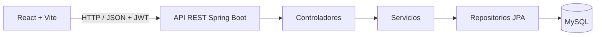

# 🍰 Pastelería Mil Sabores

### Tienda online Fullstack | Evaluación Parcial N.º 3

**Asignatura:** Desarrollo Fullstack II (DSY1104)  
**Institución:** Duoc UC

Aplicación de comercio electrónico para **Pastelería Mil Sabores**, desarrollada con un frontend en **React 18 y Vite** y un backend **Java 21 con Spring Boot 3.3.4**. La aplicación permite explorar productos, gestionar compras y administrar recursos según los permisos de cada usuario.

El frontend se comunica con el backend mediante una **API REST**, utilizando **MySQL** para la persistencia de datos y **JWT** para la autenticación.

## 🌐 Demostración

- [Sitio publicado en GitHub Pages](https://vguzc.github.io/Pasteleria_Mil_Sabores_P1_FSII/)

**Nota:** El despliegue estático del frontend no implica que el backend o la base de datos estén disponibles públicamente. Para probar la integración completa, deben ejecutarse los servicios localmente.

## 🧰 Tecnologías utilizadas

| Capa | Tecnologías |
| --- | --- |
| Frontend | React 18, React Router 6, Vite 5, Bootstrap 5, JavaScript, HTML y CSS |
| Backend | Java 21, Spring Boot 3.3.4, Spring Web, Spring Data JPA |
| Base de datos | MySQL, Hibernate/JPA |
| Seguridad | Spring Security, JWT, BCrypt, roles de usuario |
| Documentación API | Swagger UI / OpenAPI |
| Pruebas frontend | Jasmine, Karma, Testing Library |
| Dependencias | npm y Maven |

## ✨ Funcionalidades principales

- Catálogo de productos y categorías.
- Búsqueda y visualización del detalle de productos.
- Carrito de compras y creación de órdenes.
- Registro e inicio de sesión de usuarios.
- Autenticación mediante tokens JWT.
- Persistencia de sesión al recargar la página.
- Administración de productos, categorías y usuarios.
- Restricciones de acceso según roles.
- Documentación interactiva de endpoints con Swagger UI.

## 🏗️ Arquitectura del sistema



El frontend realiza peticiones desde `src/services/api.js` a `http://localhost:8080/api`.

Cuando existe un token, el cliente HTTP añade la cabecera `Authorization: Bearer <token>`. El backend valida el JWT mediante Spring Security y aplica los permisos configurados antes de ejecutar las operaciones protegidas.

## 🚀 Instalación y ejecución

### Requisitos previos

- Node.js 18 o superior y npm.
- JDK 21 y Maven.
- MySQL en funcionamiento.
- Navegador web.

### 1. Preparar la base de datos

Iniciar MySQL e importar el script:

```text
database/pasteleria_mil_sabores.sql
```

Verificar que la base de datos se llame `pasteleria_mil_sabores_db`.

Revisar la configuración de conexión en:

```text
backend/src/main/resources/application.properties
```

Por defecto, el proyecto configura MySQL en `localhost:3306`, usuario `root` y contraseña vacía. Estos valores deben adaptarse al entorno de ejecución.

### 2. Ejecutar el backend

Desde la raíz del proyecto:

```bash
cd backend
mvn spring-boot:run
```

API REST: http://localhost:8080

Swagger UI: http://localhost:8080/swagger-ui.html

### 3. Ejecutar el frontend

En otra terminal, desde la raíz del proyecto:

```bash
npm install
npm run dev
```

Abrir la dirección local que indique Vite.

Para probar la integración completa, mantener frontend, backend y MySQL ejecutándose simultáneamente.

### 4. Compilar y ejecutar pruebas

```bash
npm run build
npm test
```

Pruebas del backend:

```bash
cd backend
mvn test
```

Los resultados deben comprobarse en el entorno de ejecución.

## 🔌 API REST

**URL base:** `http://localhost:8080/api`

| Método | Endpoint | Descripción |
| --- | --- | --- |
| POST | /auth/login | Inicio de sesión |
| POST | /auth/registro | Registro de usuario |
| GET | /auth/me | Usuario autenticado |
| GET | /productos | Listar productos |
| GET | /productos/{id} | Consultar producto |
| POST | /productos | Crear producto |
| PUT | /productos/{id} | Actualizar producto |
| DELETE | /productos/{id} | Eliminar producto |
| GET | /categorias | Listar categorías |
| POST | /categorias | Crear categoría |
| PUT | /categorias/{id} | Actualizar categoría |
| DELETE | /categorias/{id} | Eliminar categoría |
| POST | /ordenes | Crear orden |
| GET | /ordenes | Consultar órdenes |
| GET | /ordenes/{id} | Consultar detalle de orden |
| GET | /usuarios | Listar usuarios |
| GET | /usuarios/{id} | Consultar usuario |
| PUT | /usuarios/{id} | Actualizar usuario |
| DELETE | /usuarios/{id} | Eliminar usuario |

Los parámetros, cuerpos de solicitud y respuestas se pueden consultar mediante Swagger UI.

## 🔐 Seguridad y autenticación

El backend implementa autenticación basada en tokens JWT utilizando Spring Security.

El proceso de autenticación consiste en:

1. El usuario ingresa sus credenciales.
2. El backend verifica los datos.
3. Si son correctos, genera un token JWT.
4. El frontend almacena el token.
5. Las solicitudes protegidas envían el token mediante la cabecera Authorization.
6. El backend valida el token y comprueba los permisos.

Las contraseñas se validan mediante BCrypt.

### Roles y permisos

| Operación | Cliente | Vendedor | Administrador |
| --- | :---: | :---: | :---: |
| Consultar catálogo | ✅ | ✅ | ✅ |
| Crear órdenes | ✅ | ✅ | ✅ |
| Crear o editar productos | ❌ | ✅ | ✅ |
| Eliminar productos | ❌ | ❌ | ✅ |
| Gestionar categorías | ❌ | ❌ | ✅ |
| Gestionar usuarios | ❌ | ❌ | ✅ |

Los permisos se configuran en el backend mediante `SecurityConfig.java`.

Las restricciones visuales del frontend complementan la seguridad, pero la autorización efectiva se realiza en el servidor.

## 🔑 Gestión de sesiones

El frontend mantiene el estado de autenticación utilizando `localStorage`.

El token JWT se conserva con la clave:

```text
mil_sabores_jwt_token
```

Esto permite recuperar la sesión cuando el usuario recarga la página.

Para un entorno productivo deben considerarse medidas adicionales de protección contra ataques XSS y una gestión segura de tokens.

## 📁 Estructura del proyecto

```text
Pasteleria_Mil_Sabores_P1_FSII-main/
├── backend/
│   ├── pom.xml
│   └── src/main/
│       ├── java/com/pasteleria/milsabores/
│       │   ├── config/
│       │   ├── controller/
│       │   ├── dto/
│       │   ├── entity/
│       │   ├── repository/
│       │   ├── security/
│       │   └── service/
│       └── resources/application.properties
├── database/
│   └── pasteleria_mil_sabores.sql
├── docs/
│   ├── DOCUMENTO_INTEGRACION.md
│   ├── MANUAL_DE_USUARIO.md
│   └── GUIA_DEFENSA_PRESENTACION.md
├── src/
├── public/
├── css/
├── js/
├── img/
├── package.json
└── README.md
```

## 📚 Documentación adicional

- [Documento de integración técnica](docs/DOCUMENTO_INTEGRACION.md): arquitectura, flujo de datos, endpoints y seguridad.
- [Manual de usuario](docs/MANUAL_DE_USUARIO.md): instrucciones para utilizar la aplicación.
- [Guía de defensa y presentación](docs/GUIA_DEFENSA_PRESENTACION.md): apoyo para la presentación individual.

## 🎓 Evaluación Parcial N.º 3

Este proyecto aborda los seis requisitos principales de la evaluación:

1. Backend conectado a una base de datos con modelos y lógica de negocio.
2. API REST con operaciones CRUD y documentación Swagger.
3. Integración frontend y backend mediante API REST.
4. Autenticación JWT y autorización por roles.
5. Persistencia de sesión en el frontend.
6. Restricciones de acceso según los permisos de usuario.

**Entregables:** repositorios de frontend y backend, proyectos comprimidos, manual de usuario y documento de integración.

## 👥 Integrantes del equipo

- Daniel Parada
- Vicente Guzman
- Guillermo Manriquez

**Asignatura:** DSY1104 – Desarrollo Fullstack II  
**Institución:** Duoc UC

---

** Pastelería Mil Sabores — Proyecto académico de comercio electrónico Fullstack.**

