# Documento de Integración Técnica
## Proyecto: Pastelería Mil Sabores
### Asignatura: DSY1104 - Desarrollo Fullstack II
### Evaluación Parcial N° 3 — Duoc UC

---

## 1. Resumen Ejecutivo y Arquitectura del Sistema

El proyecto **Pastelería Mil Sabores** implementa una arquitectura desacoplada Fullstack compuesta por:
1. **Capa Cliente (Frontend)**: Desarrollada en **React 18** con empaquetador **Vite**, gestionada mediante componentes funcionales, hooks, Context API (`AuthContext`, `CartContext`) y estilos responsivos con **Bootstrap 5**.
2. **Capa Servidor (Backend)**: Desarrollada en **Java 21/24** con el framework **Spring Boot 3.3**, estructurada en capas desacopladas (Controlador, Servicio, Repositorio, Entidad y Seguridad).
3. **Capa de Persistencia (Base de Datos)**: Servidor relacional **MySQL** administrado a través de **XAMPP / MariaDB**, con conexión gestionada mediante **Spring Data JPA** e **Hibernate**.
4. **Capa de Seguridad**: Implementación de **Spring Security 6** con autenticación sin estado (*stateless*) mediante **JSON Web Tokens (JWT)** y control de acceso basado en roles (*Role-Based Access Control - RBAC*).

```mermaid
flowchart LR
    subgraph Frontend["Frontend (React 18 + Vite)"]
        UI["Interfaz de Usuario (Vistas Tienda / Panel Admin)"]
        CTX["Contextos (AuthContext / CartContext)"]
        API_CLIENT["Cliente HTTP REST (src/services/api.js)"]
    end

    subgraph Backend["Backend (Spring Boot 3.3)"]
        FILTER["Filtro JWT (JwtAuthenticationFilter)"]
        SEC["Spring Security (RBAC Roles)"]
        CTRL["Controladores REST (@RestController)"]
        SERV["Servicios de Negocio (@Service)"]
        REPO["Repositorios JPA (JpaRepository)"]
        SWAGGER["Documentación Swagger / OpenAPI"]
    end

    subgraph Database["Base de Datos (MySQL - XAMPP)"]
        DB[("pasteleria_mil_sabores_db")]
    end

    UI --> CTX
    CTX --> API_CLIENT
    API_CLIENT -- "HTTP JSON + Authorization: Bearer <JWT>" --> FILTER
    FILTER --> SEC
    SEC --> CTRL
    CTRL --> SERV
    SERV --> REPO
    REPO -- "JDBC / Hibernate" --> DB
    CTRL -.-> SWAGGER
```



---

## 2. Especificación de Endpoints de la API REST

La API REST expone servicios organizados bajo el prefijo `/api` y documentados interactivamente con **Swagger UI** en `http://localhost:8080/swagger-ui.html`.

### 2.1 Módulo de Autenticación (`/api/auth`)
| Método | Endpoint | Acceso | Descripción |
| :--- | :--- | :--- | :--- |
| `POST` | `/api/auth/login` | Público | Autentica con correo y clave. Retorna token JWT y perfil de usuario. |
| `POST` | `/api/auth/registro` | Público | Registra un nuevo cliente con clave encriptada (BCrypt) y emite token JWT. |
| `GET` | `/api/auth/me` | Autenticado | Retorna los datos del usuario autenticado a partir del token Bearer. |

### 2.2 Módulo de Catálogo de Productos (`/api/productos`)
| Método | Endpoint | Rol Requerido | Descripción |
| :--- | :--- | :--- | :--- |
| `GET` | `/api/productos` | Público | Lista todos los productos. Parámetros opcionales: `categoria`, `destacados`, `ofertas`, `q`. |
| `GET` | `/api/productos/{id}` | Público | Retorna el detalle de un producto por ID numérico o código (`TC001`, etc.). |
| `POST` | `/api/productos` | `ADMINISTRADOR` | Registra un nuevo producto en el catálogo. |
| `PUT` | `/api/productos/{id}` | `ADMINISTRADOR` | Modifica atributos, precios o stock de un producto existente. |
| `DELETE` | `/api/productos/{id}` | `ADMINISTRADOR` | Elimina un producto de la base de datos. |

### 2.3 Módulo de Categorías (`/api/categorias`)
| Método | Endpoint | Rol Requerido | Descripción |
| :--- | :--- | :--- | :--- |
| `GET` | `/api/categorias` | Público | Retorna el listado completo de categorías. |
| `GET` | `/api/categorias/{id}` | Público | Obtiene el detalle de una categoría específica. |
| `POST` | `/api/categorias` | `ADMINISTRADOR` | Crea una nueva categoría. |
| `PUT` | `/api/categorias/{id}` | `ADMINISTRADOR` | Actualiza nombre o descripción de una categoría. |
| `DELETE` | `/api/categorias/{id}` | `ADMINISTRADOR` | Elimina una categoría del sistema. |

### 2.4 Módulo de Órdenes y Compras (`/api/ordenes`)
| Método | Endpoint | Rol Requerido | Descripción |
| :--- | :--- | :--- | :--- |
| `POST` | `/api/ordenes` | Autenticado | Registra una orden de compra, descuenta stock y la asocia al usuario. |
| `GET` | `/api/ordenes` | Autenticado | Clientes ven sus propias órdenes; Administradores y Vendedores ven todas. |
| `GET` | `/api/ordenes/{id}` | Autenticado | Retorna el detalle con los productos asociados a una orden. |

### 2.5 Módulo de Administración de Usuarios (`/api/usuarios`)
| Método | Endpoint | Rol Requerido | Descripción |
| :--- | :--- | :--- | :--- |
| `GET` | `/api/usuarios` | `ADMINISTRADOR` | Lista todos los usuarios registrados y sus roles asociados. |
| `GET` | `/api/usuarios/{id}` | `ADMINISTRADOR` | Retorna los detalles de un usuario. |
| `PUT` | `/api/usuarios/{id}` | `ADMINISTRADOR` | Actualiza rol o información de contacto de un usuario. |
| `DELETE` | `/api/usuarios/{id}` | `ADMINISTRADOR` | Elimina un usuario del sistema. |

---

## 3. Seguridad, Autenticación y Control de Roles (JWT)

### 3.1 Proceso de Autenticación
1. El usuario ingresa sus credenciales en el formulario de login de React.
2. El cliente ejecuta una petición `POST /api/auth/login` con el payload JSON `{ correo, clave }`.
3. Spring Security intercepta la petición a través del `AuthenticationManager`:
   - `CustomUserDetailsService` consulta la tabla `usuarios` en MySQL.
   - `BCryptPasswordEncoder` verifica que la contraseña coincida con el hash almacenado.
4. Si las credenciales son válidas, `JwtTokenProvider` genera un token firmado criptográficamente con algoritmo **HMAC-SHA256**:
   - `Subject`: correo electrónico del usuario.
   - `Claim 'roles'`: rol asignado (`ROLE_ADMINISTRADOR`, `ROLE_VENDEDOR`, `ROLE_CLIENTE`).
   - `Expiración`: 24 horas (86.400.000 ms).
5. El token y el perfil de usuario se envían en la respuesta HTTP 200.

### 3.2 Persistencia de Sesión y Comunicación Segura en el Frontend
* El token JWT se almacena de forma persistente en `localStorage` bajo la clave `mil_sabores_jwt_token`.
* `src/services/api.js` intercepta cada solicitud saliente e inyecta la cabecera:
  ```http
  Authorization: Bearer <TOKEN_JWT>
  ```
* En caso de recarga del navegador (`F5`), `AuthContext.jsx` lee el token almacenado y valida la sesión contra `/api/auth/me`, manteniendo el estado de autenticación de forma segura y transparente para el usuario.

### 3.3 Control de Acceso por Roles (RBAC)
* **En el Backend**: Los endpoints están protegidos mediante directivas `@PreAuthorize("hasRole('ADMINISTRADOR')")` y filtros en `SecurityConfig.java`. Si un usuario intenta acceder a un recurso sin los privilegios requeridos, el servidor responde con código de estado HTTP **403 Forbidden**.
* **En el Frontend**: Las rutas están protegidas en `src/layouts/AdminLayout.jsx`. Solo los usuarios con rol `administrador` o `vendedor` pueden acceder al panel administrativo (`/admin`). Los clientes convencionales son redirigidos automáticamente a `/mi-cuenta`. Adicionalmente, la pestaña `/admin/usuarios` es visible y accesible únicamente por el rol `administrador`.

---

## 4. Política de Intercambio de Recursos de Origen Cruzado (CORS)

Para permitir que la aplicación cliente en React (`http://localhost:3000` o `http://localhost:5173`) consuma los servicios del backend Spring Boot (`http://localhost:8080`), se configuró en `SecurityConfig.java` una política CORS que:
* Habilita los métodos HTTP: `GET`, `POST`, `PUT`, `DELETE`, `OPTIONS`, `PATCH`.
* Permite las cabeceras: `Authorization`, `Content-Type`, `Accept`, `Origin`.
* Expone la cabecera `Authorization`.
* Habilita credenciales (`allowCredentials: true`).

---

## 5. Instrucciones de Despliegue y Ejecución Local

### Paso 1: Levantar la Base de Datos
1. Iniciar Apache y MySQL en **XAMPP Control Panel**.
2. Abrir phpMyAdmin en `http://localhost/phpmyadmin`.
3. Importar el script `database/pasteleria_mil_sabores.sql`.

### Paso 2: Levantar el Backend (Spring Boot)
1. Abrir una terminal en la carpeta `backend/`.
2. Ejecutar:
   ```bash
   mvn spring-boot:run
   ```
3. Verificar que el servidor inicie en el puerto 8080 y acceder a Swagger en:
   `http://localhost:8080/swagger-ui.html`

### Paso 3: Levantar el Frontend (React)
1. Abrir una terminal en la raíz del proyecto `Parcial_1/`.
2. Ejecutar:
   ```bash
   npm run dev
   ```
3. Abrir en el navegador: `http://localhost:3000/`.
